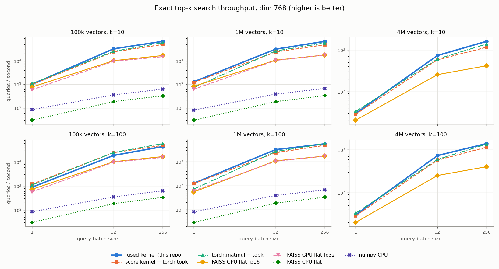
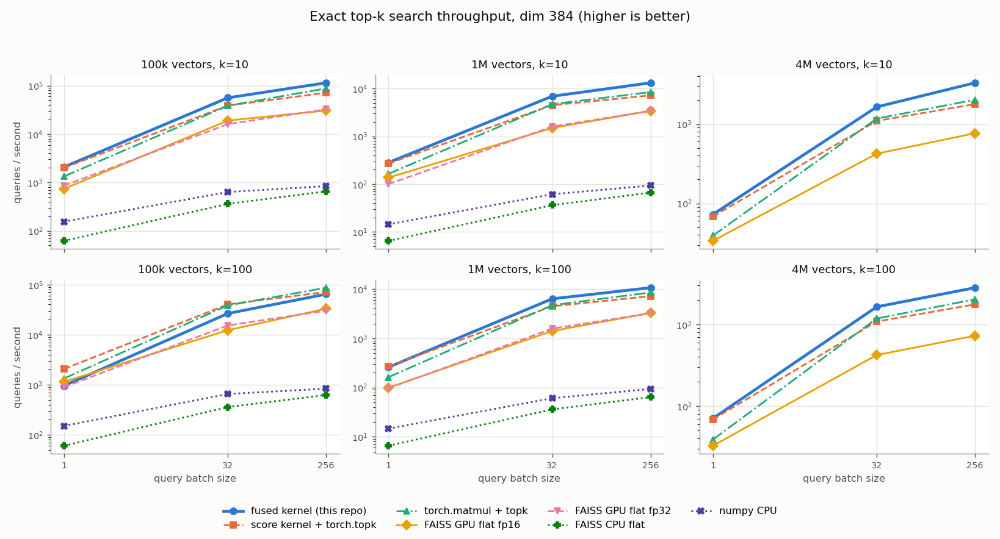

# cuda-vector-search

Exact (brute-force) top-k similarity search on the GPU, written as custom CUDA
kernels. It is meant for the retrieval step of a RAG system when the corpus is
somewhere between a few thousand and a few million embeddings: small enough to
sit in GPU memory, big enough that numpy on the CPU starts to hurt, and not
big enough to justify building and tuning an approximate index.

```python
from cuda_vector_search import Index

index = Index(embeddings, metric="cosine")     # [n, d] numpy or torch, stored as fp16 on the GPU
scores, ids = index.search(queries, k=10)      # [b, k] float32, [b, k] int64, best first
index.save("corpus.npy")
index = Index.load("corpus.npy")
```

Two kernels do the work:

1. **Score kernel.** fp16 dot products between a batch of queries and the
   corpus, tiled through shared memory and computed on tensor cores with WMMA
   (16x16x16 fp16 fragments, fp32 accumulation). Works on any GPU from Volta
   (sm_70) up; the numbers below are from a T4 (sm_75).
2. **Fused score + top-k kernel.** The same tile loop, but each block keeps a
   running top-k per query in registers and throws the scores away. The full
   `batch x n` score matrix is never written to global memory. A small merge
   kernel combines the per-block lists.

There is also a plain PyTorch path (`torch.matmul` + `torch.topk`) used as the
reference and as a fallback (CPU, or k > 256).

## Results on a Tesla T4

Measured on 2026-10-19 in a Kaggle notebook: one Tesla T4 (sm_75, 40 SMs,
15 GB), PyTorch 2.11.0 with CUDA 12.8, nvcc 12.8, driver 580.178.04,
FAISS 1.14.1 (`faiss-gpu-cu12`), numpy 2.1.3, 4 vCPUs. Corpus and queries are
random unit vectors stored as fp16. Every number is the median of repeated
calls after warm-up, timed on the host with a device sync, for a whole batch.
Raw data: [`results/t4.json`](results/t4.json).




**The short version.**

- From 1M vectors up, the fused kernel is the fastest method in 20 of 24
  configurations. In 19 of the 24 it is 1.15x to 1.85x faster than
  `torch.matmul` + `torch.topk` on the same GPU, and it is 1.5x to 4.6x faster
  than FAISS GPU flat in all 24.
- It never allocates the score matrix. At batch 256 the torch path needs an extra
  497 MB (1M vectors) or 1.99 GB (4M vectors) of GPU memory; the fused path
  needs 2 MB.
- Its results are exact: recall@k = 1.0 against fp32 math in every
  configuration. The torch path stores fp16 scores, so near-ties at the k-th
  place can flip; its recall dipped to 0.975.
- Against the CPU it is not close. At 1M x 384, batch 256, k=10 it takes
  19.4 ms; numpy takes 2.7 s and FAISS CPU flat 3.9 s on the 4 vCPUs Kaggle gives you.

**Where it loses, and why.**

- **Small corpus, large k (100k vectors, k=100).** torch wins by about 1.2x to
  1.45x. With only 100k vectors the matrix multiply is a fraction of a
  millisecond, so the fixed cost of the top-k selection (filling and
  maintaining 100-entry lists in registers, then merging the lists from every
  chunk) is a large share of the total. cuBLAS + `torch.topk` on a 25 MB score
  matrix is cheap at that size.
- **Batch 1 at dim 768 (100k and 4M).** torch is 7 to 10% faster. A single
  query is a matrix-vector product, so it is purely memory-bound: the kernel
  reads the 6.3 GB corpus (4M x 768) at about 188 GB/s versus about 208 GB/s
  for cuBLAS. The tensor-core tiling buys nothing here because 15 of the 16 query rows in a
  tile are padding.
- **Big batch, big k, big dim (1M x 768, batch 256, k=100).** A tie (46.1 vs
  44.9 ms), for the reason in the next point.
- **Raw matrix multiply.** The WMMA tile reaches 10.5 to 11.5 TFLOP/s versus
  13.6 to 14.7 TFLOP/s for cuBLAS (table below), about 75 to 80%. cuBLAS uses
  hand-tuned SASS, larger tiles and better software pipelining. The fused kernel
  wins overall anyway because it skips writing and re-reading the score
  matrix, which at batch 256 and 1M vectors is 512 MB of fp16 traffic each way.
  When the multiply dominates (dim 768, batch 256, k=100) the two end up even.
- **FAISS.** FAISS GPU flat is slower than plain torch here. Part of that is
  this benchmark: FAISS is called with numpy arrays, so each call includes a
  host-to-device copy of the queries and a device-to-host copy of the results.
  The fp32 index also runs its multiply in fp32 without tensor cores. The
  fp16 index was not faster in these runs and I have not dug into why. FAISS's
  real strength is its approximate indexes (IVF, PQ, CAGRA), which are not
  compared here.

Absolute numbers move between Kaggle sessions: two earlier smoke runs on
different T4s measured cuBLAS between 12.4 and 18.4 TFLOP/s for the same
multiply. Compare methods within one run, not across runs.

<details>
<summary>All configurations (latency in ms)</summary>

Columns: `fused` = fused kernel, `twopass` = this repo's score kernel then
`torch.topk`, `torch` = `torch.matmul` + `torch.topk`, `faiss_*` = FAISS
`IndexFlatIP` (GPU with fp16 or fp32 storage, and CPU), `numpy` = matmul +
`argpartition`. CPU baselines and FAISS GPU fp32 were skipped at 4M vectors
(memory and time).

**dim 384**, median latency per batch in ms (lower is better). Bold = fastest in the row.

| corpus | k | batch | fused | twopass | torch | faiss_gpu_fp16 | faiss_gpu_fp32 | faiss_cpu | numpy | fused vs torch |
|---|---|---|---|---|---|---|---|---|---|---|
| 100k | 10 | 1 | **0.479** | 0.499 | 0.749 | 1.36 | 1.17 | 16.1 | 6.47 | 1.57x |
| 100k | 10 | 32 | **0.569** | 0.823 | 0.83 | 1.68 | 1.99 | 88.6 | 50.4 | 1.46x |
| 100k | 10 | 256 | **2.23** | 3.57 | 2.9 | 8.34 | 7.9 | 392 | 305 | 1.30x |
| 100k | 100 | 1 | 1.05 | **0.485** | 0.75 | 0.874 | 1.12 | 16.6 | 6.65 | 0.72x |
| 100k | 100 | 32 | 1.21 | **0.794** | 0.834 | 2.61 | 2.09 | 89.3 | 49 | 0.69x |
| 100k | 100 | 256 | 3.97 | 3.6 | **2.96** | 7.77 | 8.5 | 411 | 307 | 0.74x |
| 1M | 10 | 1 | **3.54** | 3.7 | 6.09 | 7.32 | 9.97 | 154 | 69.5 | 1.72x |
| 1M | 10 | 32 | **4.63** | 7.13 | 6.78 | 21.3 | 20.1 | 881 | 521 | 1.46x |
| 1M | 10 | 256 | **19.4** | 35.6 | 30.3 | 75.1 | 74.6 | 3855 | 2742 | 1.56x |
| 1M | 100 | 1 | 3.85 | **3.7** | 6.14 | 10.1 | 10.3 | 152 | 68.1 | 1.59x |
| 1M | 100 | 32 | **5.04** | 7.15 | 6.81 | 22.7 | 20.3 | 887 | 526 | 1.35x |
| 1M | 100 | 256 | **24.1** | 35.6 | 30 | 78.5 | 79.1 | 3997 | 2726 | 1.25x |
| 4M | 10 | 1 | **13.8** | 14.6 | 25.5 | 29.7 |  |  |  | 1.85x |
| 4M | 10 | 32 | **19.5** | 29.2 | 27.3 | 75.6 |  |  |  | 1.40x |
| 4M | 10 | 256 | **77.3** | 144 | 127 | 334 |  |  |  | 1.64x |
| 4M | 100 | 1 | **14.2** | 14.6 | 25.8 | 30.7 |  |  |  | 1.82x |
| 4M | 100 | 32 | **19.5** | 29.5 | 27.1 | 76 |  |  |  | 1.39x |
| 4M | 100 | 256 | **90.9** | 145 | 126 | 352 |  |  |  | 1.39x |

**dim 768**, median latency per batch in ms (lower is better). Bold = fastest in the row.

| corpus | k | batch | fused | twopass | torch | faiss_gpu_fp16 | faiss_gpu_fp32 | faiss_cpu | numpy | fused vs torch |
|---|---|---|---|---|---|---|---|---|---|---|
| 100k | 10 | 1 | 1 | 1.02 | **0.932** | 1.3 | 1.71 | 33.3 | 11.9 | 0.93x |
| 100k | 10 | 32 | **0.989** | 1.33 | 1.27 | 3.15 | 3.35 | 172 | 89.1 | 1.29x |
| 100k | 10 | 256 | **3.82** | 5.19 | 4.34 | 15.3 | 17 | 786 | 410 | 1.13x |
| 100k | 100 | 1 | 1.13 | **0.848** | 0.916 | 1.39 | 1.77 | 33.4 | 12 | 0.81x |
| 100k | 100 | 32 | 1.7 | 1.3 | **1.28** | 3.12 | 3.25 | 175 | 91.3 | 0.75x |
| 100k | 100 | 256 | 5.83 | 5.2 | **4.38** | 15.2 | 16.6 | 766 | 405 | 0.75x |
| 1M | 10 | 1 | **7.78** | 8.26 | 13.7 | 12.1 | 16.2 | 329 | 123 | 1.76x |
| 1M | 10 | 32 | **10.2** | 13.5 | 12.3 | 30.1 | 30.8 | 1734 | 832 | 1.20x |
| 1M | 10 | 256 | **38.2** | 53 | 44.5 | 145 | 146 | 7741 | 3828 | 1.17x |
| 1M | 100 | 1 | **8** | 8.22 | 13.9 | 18.4 | 16.6 | 341 | 124 | 1.74x |
| 1M | 100 | 32 | **10.1** | 13.5 | 12.1 | 29.4 | 30.8 | 1734 | 819 | 1.20x |
| 1M | 100 | 256 | 46.1 | 53.1 | **44.9** | 150 | 149 | 7784 | 3855 | 0.98x |
| 4M | 10 | 1 | 33.5 | 35 | **30.2** | 48.7 |  |  |  | 0.90x |
| 4M | 10 | 32 | **43.6** | 55.3 | 53 | 126 |  |  |  | 1.21x |
| 4M | 10 | 256 | **160** | 221 | 185 | 615 |  |  |  | 1.16x |
| 4M | 100 | 1 | 33.2 | 34.9 | **30.3** | 50.1 |  |  |  | 0.91x |
| 4M | 100 | 32 | **43.6** | 55.8 | 53.7 | 127 |  |  |  | 1.23x |
| 4M | 100 | 256 | **183** | 222 | 188 | 635 |  |  |  | 1.03x |

**Score matrix only** (no top-k), fp16 output:

| corpus | dim | batch | custom WMMA ms | cuBLAS ms | custom TFLOP/s | cuBLAS TFLOP/s |
|---|---|---|---|---|---|---|
| 100k | 384 | 256 | 1.78 | 1.338 | 11.05 | 14.69 |
| 1M | 384 | 256 | 18.298 | 13.694 | 10.74 | 14.36 |
| 4M | 384 | 256 | 74.66 | 57.995 | 10.53 | 13.56 |
| 100k | 768 | 256 | 3.428 | 2.797 | 11.47 | 14.06 |
| 1M | 768 | 256 | 34.686 | 26.75 | 11.34 | 14.7 |
| 4M | 768 | 256 | 146.628 | 114.197 | 10.73 | 13.77 |

**Recall@k vs fp32 exact search** (first 8 queries of every config; min / mean):

| method | min | mean |
|---|---|---|
| fused | 1.0000 | 1.0000 |
| twopass | 0.9875 | 0.9971 |
| torch | 0.9750 | 0.9967 |
| faiss_gpu_fp16 | 1.0000 | 1.0000 |
| faiss_gpu_fp32 | 1.0000 | 1.0000 |
| faiss_cpu | 1.0000 | 1.0000 |
| numpy | 1.0000 | 1.0000 |

</details>

The fused kernel's queries-per-block and chunk count were tuned with
`bench/sweep.py` (raw data in `results/sweep_t4_d384.json` and
`results/sweep_t4_d768.json`). The main finding: fewer, longer chunks are
better. One or two blocks per SM in total beat eight per SM by up to 45%,
because every chunk pays a warm-up and adds k candidates to the merge.


## When exact GPU search is the right tool (and when it isn't)

Exact search is worth it when:

- **The corpus fits in GPU memory.** fp16 costs `2 * d` bytes per vector, so
  1M x 768 is 1.5 GB and 4M x 768 is 6.1 GB. A 16 GB T4 holds about 8M
  vectors at d=768.
- **The corpus changes often.** Adding vectors is a memory copy. There is no
  index to rebuild, no training step, no recall to re-tune.
- **You need the true top-k.** Legal, medical or deduplication work where a
  missed neighbour matters, or as the ground truth when you evaluate an ANN index.
- **Queries come in batches.** Batching reuses each corpus tile for many
  queries, which is where the GPU pulls far ahead of the CPU.

An ANN index (FAISS IVF/HNSW, ScaNN, a vector database) wins when:

- **The corpus is much larger than a few million vectors** or does not fit in
  GPU memory. Brute force costs `O(n * d)` per query; at 100M vectors an IVF or
  HNSW index answers in a fraction of the time with 95-99% recall.
- **You serve single queries at very low latency on CPU-only machines.**
- **Memory is the constraint.** Product quantisation stores a 768-d vector in
  tens of bytes instead of 1.5 KB.

## How the kernels work

**Tiling.** A block of 256 threads (8 warps) computes a `BQ x 128` tile of
scores: `BQ` queries (16, 32 or 64) against 128 corpus rows. Each step loads a
64-wide slice of both into shared memory (16-byte vector loads, rows padded by 8
halves to avoid bank conflicts). The 8 warps split the tile and each computes
a 16x16, 16x32 or 32x32 sub-tile (one, two or four WMMA accumulators), so
each fragment it loads from shared memory is used more than once. While the tensor cores work
on one slice, the next slice is already being fetched into registers, so the
global loads overlap with the math. The vector width is zero-padded to a
multiple of 64 (384 and 768 need no padding).

**Fused top-k.** The corpus is split into chunks along `grid.y`, sized so the
whole grid is one or two blocks per SM (measured to be the sweet spot, see
below). A block walks its chunk tile by tile. After a
tile is computed, its scores sit in shared memory and each warp takes
`BQ/8` queries. For each query the warp holds the current best k in registers,
spread across its 32 lanes (`ceil(k/32)` slots per lane), plus the k-th best
value as a threshold. Each lane reads one score, a single `__ballot_sync` asks
"does anybody beat the threshold?", and in the common case the answer is no and
the warp moves on. When a lane does beat it, the candidate replaces the current
minimum and the warp recomputes the minimum with a 5-step butterfly shuffle.
After the first few tiles almost every candidate is rejected by that one
ballot, so selection costs far less than the matrix multiply.

Each block writes k unsorted candidates per query; the merge kernel (one warp
per query) runs the same selection over `chunks x k` candidates and emits them
sorted by score, ties broken by smaller id.

The top-k state lives in registers, so the block's query count shrinks as k
grows (`BQ * ceil(k/32) <= 256`): k up to 128 can use 64 queries per block,
k up to 256 uses 32. ptxas reports no register spills for any of the variants.

**What it does not do.** No cp.async/TMA pipeline (T4 has neither), no
split-K, no int8. The tile shape is fixed. Worst-case input for the selection
is a corpus sorted by ascending score, where every candidate is an insertion;
real embeddings behave like the random data used here.

## Correctness

`tests/test_search.py` compares every path against fp32 math on the stored
fp16 vectors. A result passes when every returned id scores at least the true
k-th best (within 1e-3, to allow for summation order), ids are unique, scores
match their ids, and rows are sorted. In other words recall@k = 1.0, ties
aside. The cases cover k = 1 to 256, corpus sizes that are not a multiple of
the tile, widths that need padding, k = n, unnormalised inner product and cosine.

On the T4: `24 passed` ([`results/pytest_t4.log`](results/pytest_t4.log)).
The benchmark also checks the first 8 queries of every configuration against
the fp32 ground truth; the fused kernel scored recall@k = 1.0 in all 36.

## Install and run

Requirements: an NVIDIA GPU with compute capability 7.0+, PyTorch with CUDA,
and the CUDA toolkit (`nvcc`) matching PyTorch's CUDA major version. The
extension is compiled on first use with `torch.utils.cpp_extension` (about a
minute) and cached.

```bash
git clone https://github.com/sonhoang/cuda-vector-search
cd cuda-vector-search
pip install -e ".[test,bench,rag]"
pytest -q                                   # GPU tests skip without CUDA
python bench/bench_gpu.py --sizes 100000,1000000 --out results/gpu.json
python bench/bench_baselines.py --sizes 100000,1000000 --out results/baselines.json
python bench/report.py results/gpu.json results/baselines.json --out results/mine.json
```

Without a GPU, `Index` still works on the CPU (plain torch, fp32), which is
handy for the example below on a laptop.

### RAG example

`examples/rag_search.py` embeds a folder of `.txt`/`.md` files with
`all-MiniLM-L6-v2` (384-d) and retrieves the best passages for a question:

```bash
python examples/rag_search.py build examples/sample_docs --out rag_index
python examples/rag_search.py ask rag_index "why does my bread go stale in the fridge?" -k 2
```

Output on the T4 run (k=2):

```
indexed 18 passages from examples/sample_docs -> /tmp/rag_index (dim 384)

Q: why does my bread go stale in the fridge?

[1] 0.827  bread.txt
    Keeping bread fresh Bread goes stale mostly because its starch recrystallises, not
    because it dries out. That process is fastest at fridge temperature, so a loaf kept in
    the refrigerator turns stale sooner than one left on the counter.

[2] 0.524  bread.txt
    For a loaf you will finish in two or three days, a paper bag or a bread box on the
    counter is best. Plastic keeps the crumb soft but makes a crisp crust go leathery.

Q: what should I do about a squeaky chain

[1] 0.704  bicycle.txt
    Bicycle chain care A chain that squeaks or looks orange needs attention. Wipe it with a
    rag while turning the pedals backwards, then put one drop of chain lubricant on each
    roller.

[2] 0.486  bicycle.txt
    Let the lube soak in for a few minutes and wipe off the excess. Oil left on the outside
    of the chain only collects grit, which grinds down the chain and the sprockets.

Q: how thick are the rings of saturn

[1] 0.753  saturn.txt
    Saturn's rings Saturn's rings are made of countless pieces of water ice, from grains of
    dust to chunks the size of a house. They span hundreds of thousands of kilometres but
    are mostly only tens of metres thick.

[2] 0.548  saturn.txt
    Measurements from the Cassini spacecraft suggest the rings may be young in astronomical
    terms, perhaps a few hundred million years old, and that they are slowly raining down
    onto the planet.
```

### Python API

```python
Index(embeddings, metric="cosine" | "ip", device=None, copy=True)
index.search(queries, k=10, method="auto" | "fused" | "twopass" | "torch")
index.scores(queries, fp32=True)       # full [b, n] matrix from the WMMA kernel
index.save(path) / Index.load(path)    # .npy (fp16) + a small .json sidecar with the metric
len(index), index.dim, index.embeddings
```

`method="auto"` uses the fused kernel when a GPU is present and k <= 256,
otherwise torch. For cosine, rows and queries are L2-normalised once (in fp32,
then stored as fp16), so cosine becomes an inner product.

### Running the benchmark on Kaggle

The numbers above come from a private Kaggle script kernel on one T4. The repo
is bundled into a single `run.py` that builds the extension, runs the tests,
both benchmark scripts, the report and the RAG demo:

```bash
export KAGGLE_USER=<your username>          # plus the usual Kaggle API credentials
python kaggle/make_kernel.py --mode full     # writes build/kaggle/{run.py,kernel-metadata.json}
kaggle kernels push -p build/kaggle
kaggle kernels status $KAGGLE_USER/cuda-vector-search-bench
kaggle kernels output $KAGGLE_USER/cuda-vector-search-bench -p out/
```

The FAISS baselines run in a separate process after the PyTorch benchmark, so
installing `faiss-gpu-cu12` can never affect the measured kernels. If the GPU
build of FAISS does not install, the script falls back to `faiss-cpu`.

## Layout

```
cuda_vector_search/csrc/kernels.cu   WMMA score tile, fused top-k, merge, bindings
cuda_vector_search/index.py          Index class, padding, normalisation, save/load
cuda_vector_search/reference.py      torch reference and chunked fp32 ground truth
tests/test_search.py                 correctness tests
bench/                               GPU benchmark, FAISS/numpy baselines, report + charts
examples/rag_search.py               sentence-transformers retrieval demo
kaggle/                              bundles the repo into a Kaggle kernel
results/                             measured T4 results (JSON, tables, charts)
```

## License

MIT, see [LICENSE](LICENSE).
